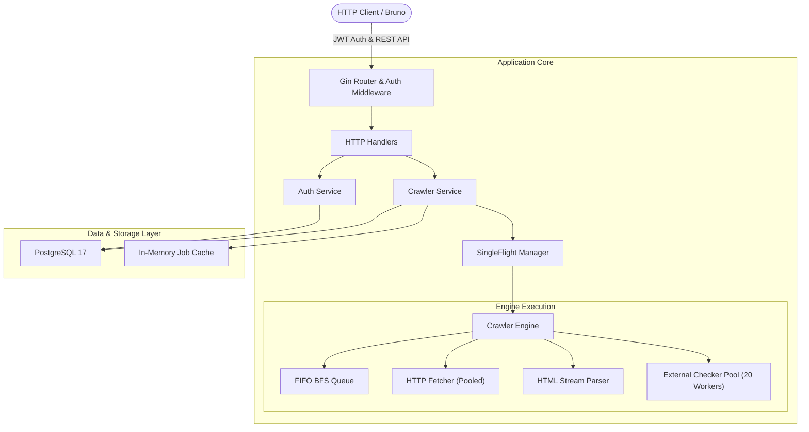

# LinkSentinel 🛡️🕷️

[](https://golang.org)
[](https://www.postgresql.org)
[](https://www.docker.com)
[](LICENSE)
[](https://github.com/milad-ghaderi-dev/link-sentinel)

**LinkSentinel** is an enterprise-grade, high-concurrency asynchronous web crawler and broken-link auditing platform engineered in Go. Designed with Clean Architecture principles, LinkSentinel rapidly maps website topologies, validates internal and external links, detects SSR/SPA rendering, enforces depth limits, and exposes advanced filtering and hierarchical tree visualization through a high-performance RESTful API.

---

## 🚀 Key Architectural Highlights

- **Clean Architecture & Domain Separation**: Clear boundaries separating HTTP Transport, Services, Repositories, Domain models, and the Crawler Engine.
- **Concurrent Worker Pools**: Bounded concurrent worker pools (20 concurrent external link validators) preventing goroutine churn, memory ballooning, and socket exhaustion.
- **SingleFlight Deduplication**: Composite `CleanURL|MaxPages` request coalescing prevents redundant simultaneous crawls of identical targets, defeating thundering-herd issues.
- **Stream-Bounded Parsing**: HTML body extraction utilizes `io.LimitReader(resp.Body, 10MB)` to safeguard against memory exhaustion attacks and oversized non-HTML payloads.
- **Connection Pool & TCP Reuse**: Configured `http.Transport` with Keep-Alive, aggressive idle timeouts, and response body draining guarantees TCP connection reuse across thousands of requests.
- **URL Fragment Stripping & Normalization**: Strips URL fragments (`#section`) to eliminate duplicate page fetches and normalizes schemes, query params, and paths.
- **Composite PostgreSQL Indexing**: High-performance multi-column B-tree indexes (`project_id` combined with `status_code`, `custom_status`, `link_type`, `depth_level`) ensure sub-millisecond query execution on millions of links.
- **Window Function Pagination**: `COUNT(*) OVER()` calculates real dataset totals, internal counts, and external counts in a single database round-trip without duplicate queries.
- **Lightweight Progress Caching**: Cleans up heavy in-memory crawler structures upon job completion, retaining only lightweight progress metadata to prevent memory leaks during long daemon runtimes.
- **Context Cancellation & Graceful Shutdown**: Full context propagation with buffered channel synchronization enables instantaneous, deadlock-free shutdowns on SIGINT / SIGTERM.
- **Zero-Trust Security & IDOR Protection**: JWT Bearer token authentication, bcrypt password hashing, and strict tenancy ownership checks on every project-scoped operation.

---

## 🏛️ System Architecture



---

## 🛠️ Technology Stack

| Component | Technology | Description |
| :--- | :--- | :--- |
| **Language** | Go 1.24+ | Idiomatic, strongly-typed concurrency with goroutines and channels |
| **Web Framework** | Gin Web Framework | High-performance routing, middleware chaining, and JSON binding |
| **Database** | PostgreSQL 17 | Relational persistence with window functions and composite indexing |
| **Database Driver**| pgx / pq | High-throughput PostgreSQL driver with native connection pooling |
| **Authentication** | JWT (golang-jwt/v5) | Stateless HMAC-SHA256 tokens with configurable expiration |
| **Security** | golang.org/x/crypto | Industry-standard bcrypt password hashing |
| **HTML Parser** | golang.org/x/net/html | Tokenized streaming HTML parsing |
| **Containerization**| Docker & Docker Compose | Multi-stage, unprivileged Alpine Linux production deployment |

---

## 🏁 Quick Start

### 1. Prerequisites
- [Go 1.24+](https://golang.org/dl/)
- [Docker & Docker Compose](https://www.docker.com/)

### 2. Clone & Setup Environment
```bash
git clone https://github.com/milad-ghaderi-dev/link-sentinel.git
cd link-sentinel
cp .env.example .env
```

### 3. Run with Docker Compose (Recommended)
Launch both PostgreSQL and the LinkSentinel API container:
```bash
docker compose up -d --build
```
The API server will be available at `http://localhost:8080`.

### 4. Run Locally (Without Docker API)
If running the PostgreSQL container alone:
```bash
docker compose up -d postgres
go run cmd/api/main.go
```

---

## 📡 API Specification

All protected endpoints require the following header:
```http
Authorization: Bearer <your_jwt_token>
```

### 🔐 Authentication

#### `POST /api/auth/register`
Create a new user account.
```json
{
  "email": "developer@sentinel.dev",
  "password": "strong_password_123"
}
```

#### `POST /api/auth/login`
Authenticate and obtain a JWT access token.
```json
{
  "email": "developer@sentinel.dev",
  "password": "strong_password_123"
}
```
**Response (200 OK):**
```json
{
  "status": "success",
  "token": "eyJhbGciOiJIUzI1NiIsInR5cCI6..."
}
```

---

### 🕷️ Crawler Operations

#### `POST /api/crawl`
Initiates an asynchronous crawl job. Supports page limits for subscription tiers or quota controls.
```json
{
  "name": "Production Audit",
  "url": "https://example.com",
  "max_pages": 100
}
```
**Response (200 OK):**
```json
{
  "status": "processing",
  "message": "Crawl job registered and running",
  "project_id": 1,
  "job_id": "job_1793374479110663423"
}
```

#### `GET /api/crawl/status/:job_id`
Poll live progress of an ongoing or recently finished job.
**Response (200 OK):**
```json
{
  "status": "success",
  "job_id": "job_1793374479110663423",
  "data": {
    "total_found": 154,
    "internal_found": 120,
    "external_found": 34,
    "is_finished": true
  }
}
```

---

### 📁 Projects & Link Analysis

#### `GET /api/projects`
List all crawl projects belonging to the authenticated user.

#### `GET /api/projects/:id`
Retrieve summary details, full internal link lists, and external link lists for a completed project.

#### `GET /api/projects/:id/tree`
Retrieve the site's discovered hierarchy tree grouped by `parent_url`.

#### `POST /api/projects/:id/search`
Perform multi-dimensional searching, filtering, and pagination over all discovered links.

**Request Payload:**
```json
{
  "link_type": "internal",
  "http_status_min": 200,
  "http_status_max": 299,
  "http_statuses": [200, 301],
  "custom_statuses": [0],
  "is_nofollow": false,
  "depth_levels": [1, 2, 3],
  "url_contains": "blog",
  "url_starts_with": "https://example.com/blog",
  "url_ends_with": ".html",
  "parent_url": "https://example.com",
  "anchor_contains": "Read More",
  "limit": 25,
  "offset": 0
}
```

**Filter Reference:**
- `link_type`: `"internal"` | `"external"` | `""` (both)
- `custom_statuses`: Custom link health indicators:
  - `0`: `OK`
  - `1`: `Empty Content`
  - `4`: `Mixed Content`
  - `5`: `Missing Href`
  - `6`: `Empty Href`
  - `7`: `Special Protocol` (`mailto:`, `tel:`, etc.)
  - `10`: `Invalid Protocol`
  - `14`: `Broken Link` (4xx, 5xx, or network failure)
  - `15`: `File Asset` (`.pdf`, `.zip`, `.png`, etc.)
  - `16`: `Duplicate URL`
  - `17`: `Forbidden` (401 / 403)
- `limit` & `offset`: Zero-overhead pagination backed by SQL window functions.

---

## 🐶 Bruno API Collection

A complete, pre-configured [Bruno](https://www.usebruno.com/) collection is included in the `/bruno` directory.

### Quick Setup:
1. Open Bruno and choose **Open Collection**.
2. Select the `bruno` directory in this repository.
3. Select the **Local** environment (`Local.bru`).
4. Execute `Auth > Login` — Bruno automatically extracts the returned JWT and stores it in your environment.
5. Execute `Crawler > Start Crawl` — `jobId` and `projectId` are automatically captured for all subsequent requests.
6. Explore pre-built filter presets under the `Projects` folder:
   - `Search Links - Broken Links`
   - `Search Links - External Links`
   - `Search Links - Keyword Search`
   - `Search Links - Pagination`
   - `Search Links - All Filters`

---

## 🧪 Testing Suite

LinkSentinel includes comprehensive unit, concurrent, and integration tests across all packages, leveraging an in-memory `http.RoundTripper` network simulator to guarantee 100% deterministic test execution with zero external network dependencies.

Run all tests:
```bash
go test -v ./...
```

Run race detector:
```bash
go test -race ./...
```

Run tests with coverage summary:
```bash
go test -coverprofile=coverage.out ./...
go tool cover -func=coverage.out
```

---

## 📁 Repository Structure

```
link-sentinel/
├── cmd/
│   └── api/
│       └── main.go                 # Application entrypoint & graceful shutdown
├── internal/
│   ├── auth/                       # JWT token management & middleware
│   ├── config/                     # Environment configuration loader
│   ├── crawler/                    # BFS engine, worker pools, fetcher, stream parser
│   ├── domain/                     # Core domain entities, contracts, error definitions
│   ├── handler/                    # Gin HTTP REST handlers
│   ├── repository/                 # PostgreSQL & in-memory thread-safe repositories
│   └── service/                    # Business services (auth & crawler orchestration)
├── bruno/                          # Production-ready Bruno API collection
├── docker-compose.yml              # Local container orchestration
├── Dockerfile                      # Multi-stage production container build
├── .env.example                    # Environment variable template
├── go.mod                          # Go module dependencies
└── README.md                       # Architectural and operational documentation
```

---

## 📄 License

This project is licensed under the MIT License - see the [LICENSE](LICENSE) file for details.
